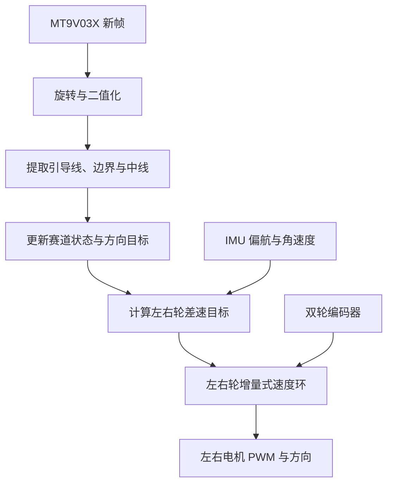

# 第二十届全国大学生智能汽车竞赛 · 缩微光电组

本仓库是南京理工大学紫金学院「赌怪爱喝卡布奇诺」队的参赛固件源码，获第二十届全国大学生智能汽车竞赛缩微光电组华东赛区二等奖。

固件基于英飞凌 CYT4BB7 和逐飞科技 CYT4BB 开源库，使用 MT9V03X 灰度摄像头识别赛道，再结合 IMU660RA 的偏航反馈和双轮编码器，通过左右电机差速循迹。IPS200 屏幕可查看图像、速度、转向误差和赛道元素状态，板载按键可在运行时调整部分参数。

## 目录结构

| 路径 | 内容 |
| --- | --- |
| [`project/iar/cyt4bb7.eww`](project/iar/cyt4bb7.eww) | IAR 工作区，包含 `cyt4bb7_cm_7_0` 和 `cyt4bb7_cm_7_1` 两个工程 |
| [`project/iar/project_config/`](project/iar/project_config/) | 各核的编译、下载和调试配置 |
| [`project/iar/icf/`](project/iar/icf/) | IAR 链接脚本 |
| [`project/user/`](project/user/) | 两个 Cortex-M7 核的入口和中断服务函数 |
| [`project/code/`](project/code/) | 比赛应用层，包括图像处理、元素识别、差速控制、显示和参数管理 |
| [`libraries/sdk/`](libraries/sdk/) | 芯片 SDK、CMSIS、底层驱动和启动代码 |
| [`libraries/zf_driver/`](libraries/zf_driver/) | GPIO、PIT、PWM、正交编码器、ADC、Flash 等片上外设封装 |
| [`libraries/zf_device/`](libraries/zf_device/) | 摄像头、IMU、IPS200、按键等板级驱动 |
| [`libraries/zf_common/`](libraries/zf_common/)、[`libraries/zf_components/`](libraries/zf_components/) | 通用接口和逐飞调试助手等组件 |

## 实现逻辑

### 双核分工与执行时序

- **CM7_0** 运行比赛主程序。启动时配置 250 MHz 系统时钟、调试串口和外设，加载源码默认参数，启动 PIT 通道 2。主循环按摄像头帧更新视觉结果，并刷新屏幕上的调试信息和 ADC 电压读数。入口在 [`main_cm7_0.c`](project/user/main_cm7_0.c)，外设初始化在 [`init.c`](project/code/init.c)。
- **CM7_1** 保留为扩展入口。目前只初始化系统时钟和调试输出，随后进入空循环。入口在 [`main_cm7_1.c`](project/user/main_cm7_1.c)。
- **PIT 通道 2** 执行 `key_scanner()` → `Attitude_Geting()` → `Speed_Get()` → `Speed_Control()` → `Mottor_Control()`。`Peripheral_Init()` 先以 `5 ms` 配置该通道，`main()` 随后传入 `5.5 ms`。速度和偏航积分使用的 `DELTA_T` 仍为 `0.005 s`。标定时应以实测中断周期为准。中断入口在 [`cm7_0_isr.c`](project/user/cm7_0_isr.c)，采样常量在 [`Speed_control.h`](project/code/Speed_control.h)。



### 从摄像头帧到循迹偏差

1. 摄像头驱动将 `mt9v03x_finish_flag` 置位后，CM7_0 读取该帧。`rotateImage180()` 把灰度图旋转 180°，`Iterative_Threshold_Opt()` 从原始灰度图估算阈值，`Binary_image()` 将旋转后的图写入 `Bmp`。当前采集分辨率为 `120 × 80`，赛道边界数组按 `120 × 60` 定义。相关代码见 [`Binary_Image.c`](project/code/Binary_Image.c)、[`image.h`](project/code/image.h) 和 [`zf_device_mt9v03x.h`](libraries/zf_device/zf_device_mt9v03x.h)。
2. `Col_border()` 提取左、右、上方引导线特征和黑白跳变点。`Prospect_Border()` 搜索逐行左右边界，记录边界长度和丢线状态。`Fitting_MiddleLine()` 根据左右边界和赛道宽度生成 `MiddleLine`。相关代码见 [`image.c`](project/code/image.c)。
3. `Road_check()` 更新 `RoadFlag`。`imageDirectionControl()` 按赛道状态选择方向控制策略。常规循迹使用第 `8`、`15`、`20`、`35` 行的加权中线，减去中心列参考值 `59` 得到 `CarInfo.dirOffset`，再进行限幅、滤波和小误差归零。相关代码见 [`RoadRecognition.c`](project/code/RoadRecognition.c) 和 [`imageDirection_Control.c`](project/code/imageDirection_Control.c)。

### 赛道元素处理

| 元素 | 识别依据 | 当前控制方式 |
| --- | --- | --- |
| 左、右直角弯 | 左右引导线组合、上方引导线和局部边界特征 | 进入直角控制阶段时清零偏航参考值并设置目标角度，速度环使用目标角度与实际偏航的差值分配左右轮速度 |
| 十字 | 左右及上方引导线、边界位置和白点统计 | 用两条前瞻行的中线估算方向，编码器累计距离超过 `cross_dis` 后退出 |
| 左、右圆环 | 单侧引导线、上方引导线、跳变点数量和赛道宽度 | 进环后参考单侧边界循迹，偏航累计达到 `circur_Angle` 后进入退出阶段 |
| 断路 | 多侧引导线消失并连续丢失边界 | 记录断路状态并按 `break_dis` 定距退出，专用定角差速分支目前处于注释状态 |
| 停车 | 源码中保留 `Stopcar()` 的识别条件 | 主流程中的识别调用和速度置零分支目前处于注释状态，台架调试时需要用电机供电开关控制停机 |

识别条件在 [`RoadRecognition.c`](project/code/RoadRecognition.c)，元素退出和偏航基准设置在 [`RoadControl.c`](project/code/RoadControl.c)。

### 从目标速度到电机输出

1. `Attitude_Geting()` 启动后先采集约 1000 次静止陀螺仪样本，随后读取 IMU660RA，更新 `CarInfo.YawRate` 并积分得到 `CarInfo.Yaw`。`Speed_Get()` 读取左右正交编码器，估算轮速并累计车辆与赛道元素的行驶距离。实现见 [`AngleCalculate.c`](project/code/AngleCalculate.c) 和 [`Speed_control.c`](project/code/Speed_control.c)。
2. 普通循迹使用方向误差的一次项、非线性项、误差变化项和偏航角速度反馈生成差速补偿。`target_left = base_speed - term`，`target_right = base_speed + term`。其中 `w_ki` 在当前转向公式中乘以 `YawRate`。
3. 左右轮分别用目标轮速和编码器轮速的误差更新增量式速度环，输出 `SL_output` 和 `SR_output`。代码也计算速度前馈 `Vl_FF` / `Vr_FF`，当前电机输出取速度环结果。`Mottor_Control()` 限制输出幅值，`Set_Duty()` 以符号控制方向引脚，以绝对值设置 PWM。实现见 [`Motor.c`](project/code/Motor.c)。

## 硬件和工具

推荐使用原工程配置对应的 **Windows + IAR Embedded Workbench for Arm 9.40.1**，并准备 CYT4BB7 主板、兼容 CMSIS-DAP 的下载器及车辆外设。工程目标器件为 `CYT4BB7CEE`，下载设置使用 CMSIS-DAP 和 Infineon CYT4 Flash Loader。逐飞原理图、板卡引脚和配套资料可见 [CYT4BB7 核心板资料](https://www.seekfree.com.cn/产品资料/核心板/英飞凌系列/cyt4bb7核心板/)。

| 硬件 | 当前配置 |
| --- | --- |
| MT9V03X 摄像头 | 灰度图 `120 × 80`，控制帧率由驱动按模块实际能力设置。接口定义见 [`zf_device_mt9v03x.h`](libraries/zf_device/zf_device_mt9v03x.h) |
| IMU660RA | 默认硬件 SPI，接口定义见 [`zf_device_imu660ra.h`](libraries/zf_device/zf_device_imu660ra.h) |
| IPS200 显示屏 | 8 位并口、竖屏，配置见 [`LCD.c`](project/code/LCD.c) 和 [`zf_device_ips200.h`](libraries/zf_device/zf_device_ips200.h) |
| 左轮电机 / 编码器 | PWM `P05_2`、方向 `P05_3`，编码器 `P17_3` / `P17_4`（`TC_CH58_ENCODER`） |
| 右轮电机 / 编码器 | PWM `P05_0`、方向 `P05_1`，编码器 `P19_2` / `P19_3`（`TC_CH27_ENCODER`） |
| 按键 | `KEY_1` 至 `KEY_4` 依次为 `P20_3`、`P20_2`、`P20_1`、`P20_0` |
| 电压检测 / 调试串口 | ADC 使用 `P07_5`，默认调试串口波特率 `115200` |

## 编译、下载和执行

### 在 IAR IDE 中构建

1. 克隆仓库并进入工程根目录。

   ```powershell
   git clone https://github.com/yanhun-kirito/20_Racecar-suoweiguangdian-.git
   Set-Location '20_Racecar-suoweiguangdian-'
   ```

2. 在 IAR 中用 **File → Open → Workspace** 打开 [`project/iar/cyt4bb7.eww`](project/iar/cyt4bb7.eww)。首次打开或移动工程目录后，对两个工程分别执行 **Project → Clean**，再选择 `Debug` 配置。
3. 分别构建 `cyt4bb7_cm_7_1` 和 `cyt4bb7_cm_7_0`。两个核的产物位于 `project/iar/project_config/Debug_m7_1/Exe/` 和 `project/iar/project_config/Debug_m7_0/Exe/`。各目录中应生成对应的 `.out` 和 `.hex`。

### 用 PowerShell 构建

从仓库根目录运行以下命令。将 `$iarBuild` 改为本机 IAR 安装目录下 `common\bin\IarBuild.exe` 的实际路径。

```powershell
$iarBuild = 'C:\Program Files\IAR Systems\Embedded Workbench 9.40\common\bin\IarBuild.exe'

foreach ($core in 1, 0) {
    & $iarBuild ".\project\iar\project_config\cyt4bb7_cm_7_$core.ewp" -build Debug -log errors
    if ($LASTEXITCODE -ne 0) {
        throw "CM7_$core 构建失败，退出码 $LASTEXITCODE"
    }
}
```

命令参数的完整说明见 [IAR 命令行构建工具文档](https://docs.iar.com/ewarm/10.1x/en/ide-project-management-and-building/building-projects/reference-information-on-building/iarbuild-the-iar-command-line-build-utility.html)。

### 下载到主板并试运行

1. 连接 CMSIS-DAP 下载器和主板，给控制板供电。首次试车时断开电机供电或架空驱动轮。当前固件初始化后会进入周期控制，启动逻辑不会等待按键。
2. 在 IAR 工作区选择 `cyt4bb7_cm_7_0`，执行 **Download and Debug**。CM7_0 的 C-SPY 配置有两个附加下载镜像，分别是仓库内自带的 [`cyt4bb7_cm_7_0.ewx`](project/iar/project_config/cyt4bb7_cm_7_0.ewx) 和刚编译生成的 `cyt4bb7_cm_7_1.hex`。下载前先生成两核产物。
3. 进入调试会话后执行 **Go（F5）**。让车辆静置完成 IMU 初始采样，再查看屏幕上的摄像头图、轮速、转向误差和 PWM。确认左右轮转向及反馈符号正确后，再接通电机供电并进行低速赛道测试。调试菜单见 [IAR C-SPY Debug 菜单说明](https://docs.iar.com/ewarm/10.1x/en/ide-project-management-and-building/menu-reference/menus/debug-menu.html)。

## 使用与调参

### 板载按键与显示

| 短按 | 实际动作 |
| --- | --- |
| `KEY_1` | `CarInfo.base_speed -= 5` |
| `KEY_2` | `CarInfo.base_speed += 5` |
| `KEY_3` | `CarInfo.w_ki -= 0.01` |
| `KEY_4` | `CarInfo.w_ki = 0.01` |

按键直接修改 RAM 中的值。调速时留意 `base_speed` 为无符号字段，按键代码未加上下限。IPS200 显示旋转后的图像、电压、二值化阈值、左右轮实际和目标速度、偏航角与角速度、方向误差、PWM 和赛道状态。主循环直接调用 [`LCD.c`](project/code/LCD.c) 中的 `OLED_SHOW()`。

### 修改默认值与标定

| 目的 | 修改入口 |
| --- | --- |
| 调整起跑后基准速度或直角弯速度 | [`Flash_save.c`](project/code/Flash_save.c) 的 `FlashData_Init()`。默认 `base_speed = 80`，初始化时 `turn_speed = base_speed * 0.5` |
| 调整普通循迹和直角弯响应 | `FlashData_Init()` 的 `w_kp1`、`w_kp2`、`w_kd`、`w_ki` 和 `a_kp`、`a_kp2`、`a_kd`、`a_kd2` |
| 调整左右轮速度环 | 同一初始化函数中的 `vl_kp`、`vr_kp`、`vl_ki`、`vr_ki` 和 `v_kd` |
| 修改十字、断路或圆环策略 | `FlashData_Init()` 中的 `cross_dis`、`break_dis`、`circur_Angle`，以及 [`RoadRecognition.c`](project/code/RoadRecognition.c) 的识别条件 |
| 更换摄像头或调整前瞻 | 摄像头驱动头文件中的采集尺寸、[`image.h`](project/code/image.h) 的算法边界尺寸以及 [`imageDirection_Control.c`](project/code/imageDirection_Control.c) 的前瞻行索引 |
| 标定里程与速度 | [`Speed_control.h`](project/code/Speed_control.h) 的 `ONE_METER = 36000` 和 `DELTA_T`。`Speed_Get()` 按每米计数求距离，以 `距离 / DELTA_T × 100` 计算轮速数值 |

`Flash_save.c` 提供按数据类型分组的 `Save_All_Data()` 和 `Read_All_Data()`。当前 `FlashData_Init()` 把自动读取放在 `#if 0` 中，按键也未接入保存调用。重新上电或复位会使用源码默认值。需要长期使用的调参值可以先改入默认值，再重新编译下载。

### 常见检查点

| 现象 | 建议检查 |
| --- | --- |
| 下载时找不到附加镜像 | 核对 `project_config/` 中的 `cyt4bb7_cm_7_0.ewx`，并确认构建生成了 `Debug_m7_1/Exe/cyt4bb7_cm_7_1.hex` |
| 上电后停在初始化 | 在 `Peripheral_Init()` 设置断点，分别核对 IMU660RA 与摄像头初始化返回值、供电和接口接线。当前初始化失败会停在 `while(1)` |
| 右轮速度或里程持续异常 | `Speed_Get()` 读取 `TC_CH27_ENCODER`，清零时使用 `TC_CH07_ENCODER`，请结合目标板接线核对该通道配置 |
| 距离、速度或出环角度与实车偏差较大 | 核对编码器计数方向、每米脉冲数和 PIT 实测周期，再观察静止时的 `YawRate` |
| IAR 中的旧源码中文注释乱码 | 部分源文件使用 GBK 兼容编码。用编辑器按 GBK 或 GB18030 重新打开即可阅读 |

## 第三方代码

逐飞科技 CYT4BB 开源库的版权和许可声明见 [`libraries/doc/GPL3_permission_statement.txt`](libraries/doc/GPL3_permission_statement.txt)，完整 GPLv3 文本见 [`libraries/LICENSE`](libraries/LICENSE)。芯片 SDK、CMSIS 和其他组件的版权与许可按各自文件和目录中的声明。逐飞开源库及原始资料见 [SeekFree/CYT4BB7_Library](https://gitee.com/seekfree/CYT4BB7_Library)。
